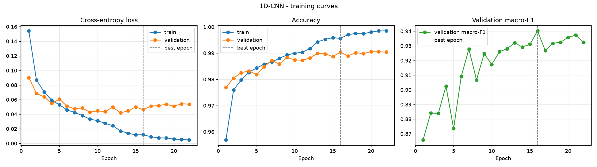
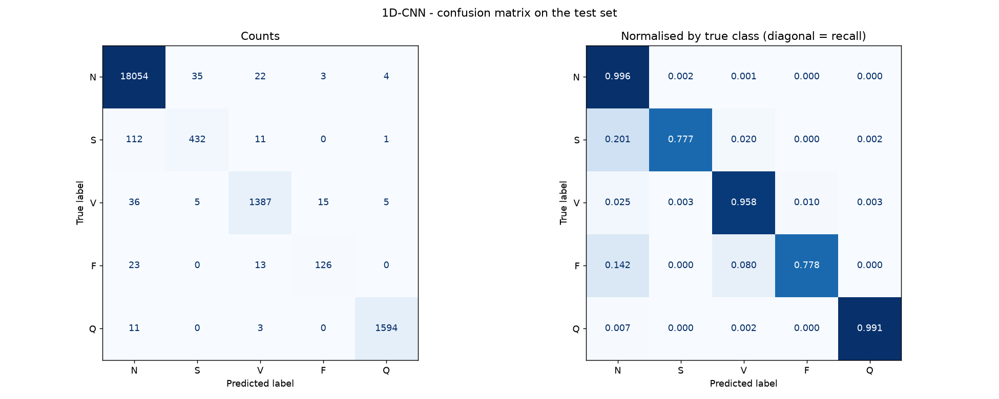
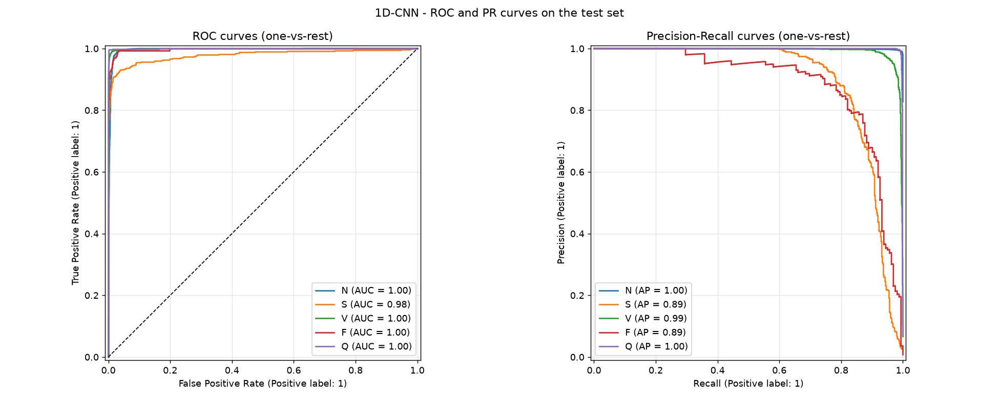
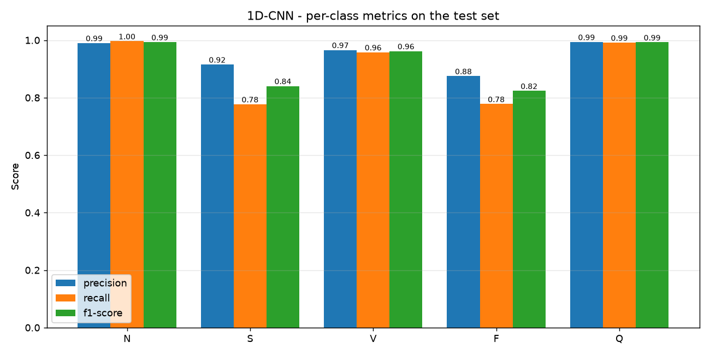
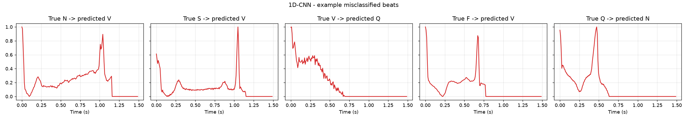
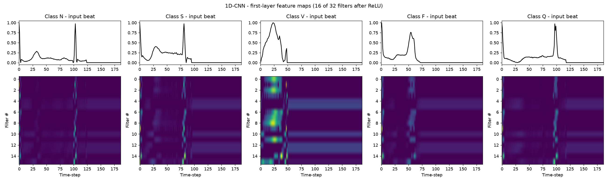

# 1D-CNN - Metrics Analysis

Test set: official MIT-BIH test split (21,892 beats), never seen during training.

## Overall metrics

| Metric | Value |
|---|---|
| Accuracy | **0.9863** |
| Precision (macro) | 0.9480 |
| Recall (macro) | 0.9001 |
| F1-score (macro) | **0.9223** |
| Precision (weighted) | 0.9859 |
| Recall (weighted) | 0.9863 |
| F1-score (weighted) | 0.9860 |
| ROC-AUC (macro, one-vs-rest) | 0.9939 |
| Trainable parameters | 429,637 |
| Epochs trained (best epoch) | 22 (16) |
| Training time (cuda) | 1.7 min |
| Inference time per beat | 0.030 ms |

## Per-class report

```
                      precision    recall  f1-score   support

          Normal (N)     0.9900    0.9965    0.9932     18118
Supraventricular (S)     0.9153    0.7770    0.8405       556
     Ventricular (V)     0.9659    0.9579    0.9619      1448
          Fusion (F)     0.8750    0.7778    0.8235       162
         Unknown (Q)     0.9938    0.9913    0.9925      1608

            accuracy                         0.9863     21892
           macro avg     0.9480    0.9001    0.9223     21892
        weighted avg     0.9859    0.9863    0.9860     21892
```

## Analysis

- **Accuracy vs macro-F1:** accuracy is 98.63%, but ~83% of test beats are Normal, so accuracy is dominated by that class. Macro-F1 (0.9223) weights all five classes equally and is the fairer single number for this imbalanced problem.
- **Strongest class:** N (F1 = 0.9932). **Weakest class:** F (F1 = 0.8235, support = 162 beats).
- **Rare classes:** the mean recall on the two rarest classes, S and F, is 0.7774. Each has under 3% of the training data, so these are the hardest classes to learn.
- **Most frequent error:** 112 true **S** beats were predicted as **N**. S beats look very similar to Normal beats in a single-beat window, since the difference is mainly early timing, so this confusion is expected.
- **Over-fitting check:** at the selected epoch, train accuracy minus validation accuracy is +0.0052 (small - mild over-fitting).
- **Separability:** a macro ROC-AUC of 0.9939 means the predicted probabilities rank the classes almost perfectly. A lot of the remaining F1 loss comes from the default arg-max decision threshold on the rare classes.

## Model-specific notes

- The CNN only looks at local windows. Its receptive field after 3 blocks is about 36 samples (~0.3 s), which covers a full QRS complex. That is why it is good at spotting abnormal beat **shapes** (V, Q).
- Convolutions run in parallel over the whole beat, so it is the fastest model to train and to run (see `feature_maps.png` for what the first-layer filters respond to).

## Figures

### Training curves


### Confusion matrix


### ROC & Precision-Recall curves


### Per-class precision / recall / F1


### Example misclassified beats


### Feature Maps

