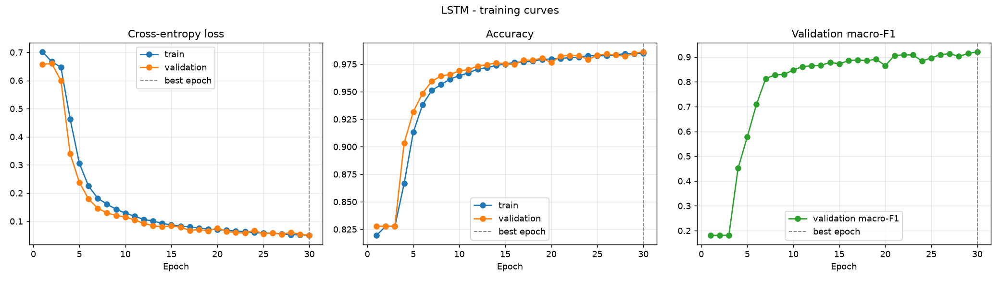
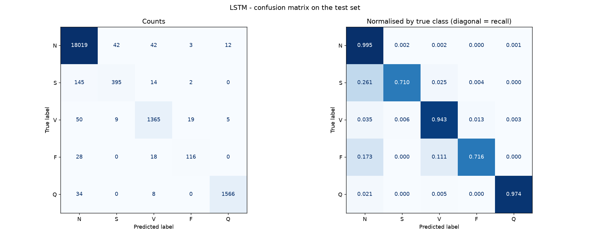
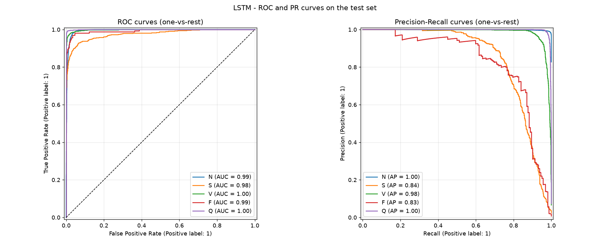
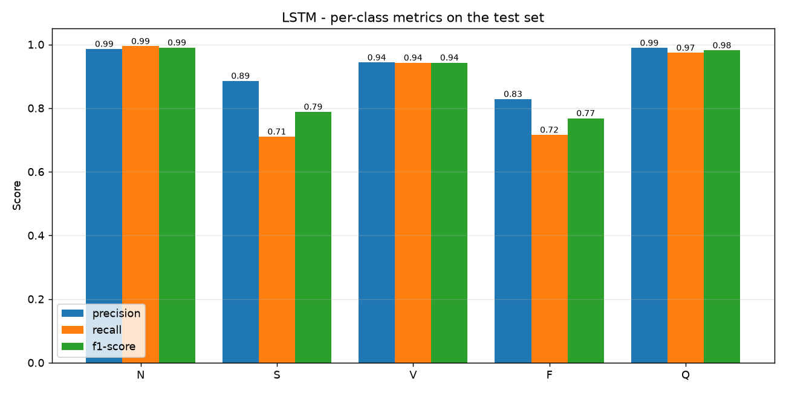
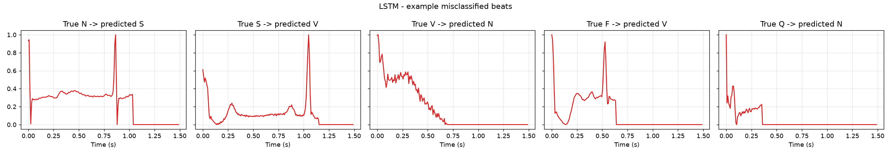
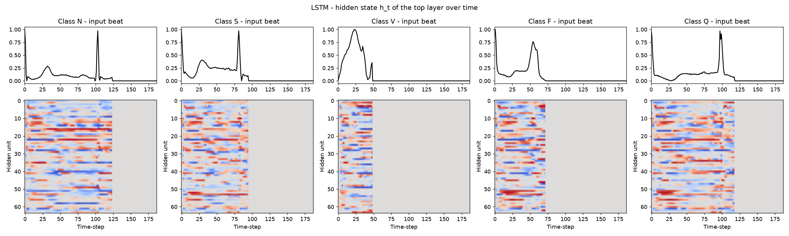

# LSTM - Metrics Analysis

Test set: official MIT-BIH test split (21,892 beats), never seen during training.

## Overall metrics

| Metric | Value |
|---|---|
| Accuracy | **0.9803** |
| Precision (macro) | 0.9266 |
| Recall (macro) | 0.8675 |
| F1-score (macro) | **0.8943** |
| Precision (weighted) | 0.9797 |
| Recall (weighted) | 0.9803 |
| F1-score (weighted) | 0.9797 |
| ROC-AUC (macro, one-vs-rest) | 0.9921 |
| Trainable parameters | 54,917 |
| Epochs trained (best epoch) | 30 (30) |
| Training time (cuda) | 20.9 min |
| Inference time per beat | 0.189 ms |

## Per-class report

```
                      precision    recall  f1-score   support

          Normal (N)     0.9859    0.9945    0.9902     18118
Supraventricular (S)     0.8857    0.7104    0.7884       556
     Ventricular (V)     0.9433    0.9427    0.9430      1448
          Fusion (F)     0.8286    0.7160    0.7682       162
         Unknown (Q)     0.9893    0.9739    0.9815      1608

            accuracy                         0.9803     21892
           macro avg     0.9266    0.8675    0.8943     21892
        weighted avg     0.9797    0.9803    0.9797     21892
```

## Analysis

- **Accuracy vs macro-F1:** accuracy is 98.03%, but ~83% of test beats are Normal, so accuracy is dominated by that class. Macro-F1 (0.8943) weights all five classes equally and is the fairer single number for this imbalanced problem.
- **Strongest class:** N (F1 = 0.9902). **Weakest class:** F (F1 = 0.7682, support = 162 beats).
- **Rare classes:** the mean recall on the two rarest classes, S and F, is 0.7132. Each has under 3% of the training data, so these are the hardest classes to learn.
- **Most frequent error:** 145 true **S** beats were predicted as **N**. S beats look very similar to Normal beats in a single-beat window, since the difference is mainly early timing, so this confusion is expected.
- **Over-fitting check:** at the selected epoch, train accuracy minus validation accuracy is -0.0013 (negligible - the model generalises well).
- **Separability:** a macro ROC-AUC of 0.9921 means the predicted probabilities rank the classes almost perfectly. A lot of the remaining F1 loss comes from the default arg-max decision threshold on the rare classes.

## Model-specific notes

- The LSTM has to process the 187 time-steps **one after another**, so it cannot be parallelised over time. That makes it the slowest model to train, as predicted on slide 12.
- It classifies from the final hidden state alone, so information from early in the beat (P wave) has to survive every later gate update to influence the decision. Beats are packed with `pack_padded_sequence`, so the LSTM stops at the real end of each beat. Without this, in a first trial run, it spent 4 epochs predicting 'Normal' for everything and only reached macro-F1 0.54 after 8 epochs, because it had to remember the beat through ~140 zero-padding steps.
- `hidden_states.png` shows how the memory changes over the beat (the flat region after the real end is padding the LSTM never processes).

## Figures

### Training curves


### Confusion matrix


### ROC & Precision-Recall curves


### Per-class precision / recall / F1


### Example misclassified beats


### Hidden States

