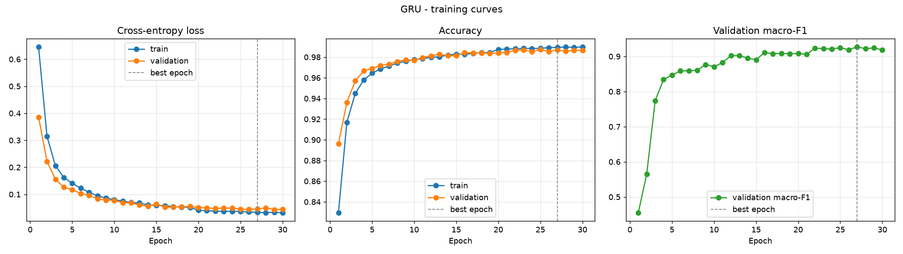
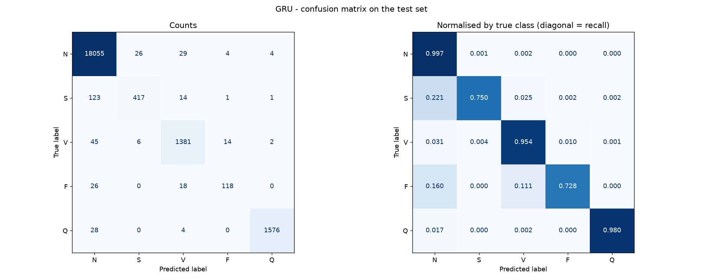
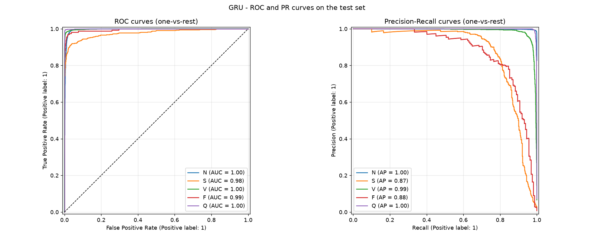
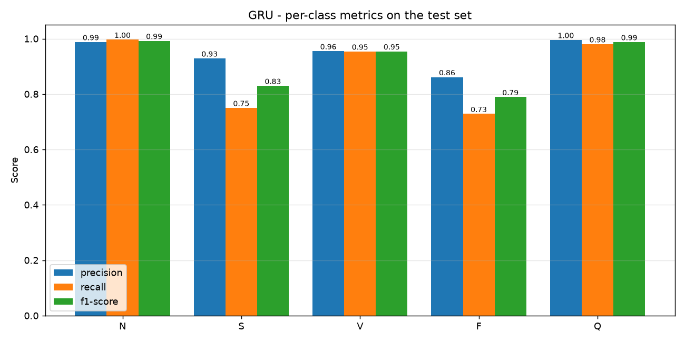
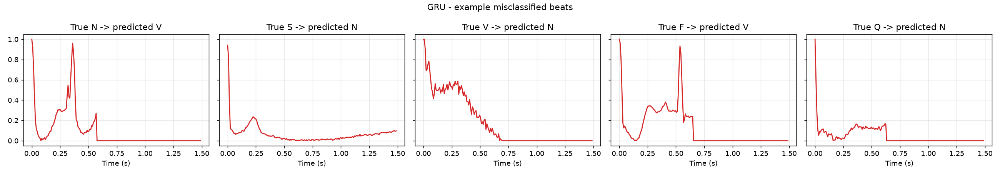
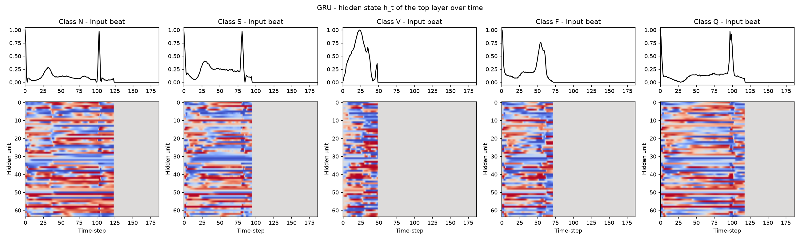

# GRU - Metrics Analysis

Test set: official MIT-BIH test split (21,892 beats), never seen during training.

## Overall metrics

| Metric | Value |
|---|---|
| Accuracy | **0.9842** |
| Precision (macro) | 0.9457 |
| Recall (macro) | 0.8817 |
| F1-score (macro) | **0.9107** |
| Precision (weighted) | 0.9838 |
| Recall (weighted) | 0.9842 |
| F1-score (weighted) | 0.9837 |
| ROC-AUC (macro, one-vs-rest) | 0.9931 |
| Trainable parameters | 42,309 |
| Epochs trained (best epoch) | 30 (27) |
| Training time (cuda) | 25.3 min |
| Inference time per beat | 0.087 ms |

## Per-class report

```
                      precision    recall  f1-score   support

          Normal (N)     0.9879    0.9965    0.9922     18118
Supraventricular (S)     0.9287    0.7500    0.8299       556
     Ventricular (V)     0.9550    0.9537    0.9544      1448
          Fusion (F)     0.8613    0.7284    0.7893       162
         Unknown (Q)     0.9956    0.9801    0.9878      1608

            accuracy                         0.9842     21892
           macro avg     0.9457    0.8817    0.9107     21892
        weighted avg     0.9838    0.9842    0.9837     21892
```

## Analysis

- **Accuracy vs macro-F1:** accuracy is 98.42%, but ~83% of test beats are Normal, so accuracy is dominated by that class. Macro-F1 (0.9107) weights all five classes equally and is the fairer single number for this imbalanced problem.
- **Strongest class:** N (F1 = 0.9922). **Weakest class:** F (F1 = 0.7893, support = 162 beats).
- **Rare classes:** the mean recall on the two rarest classes, S and F, is 0.7392. Each has under 3% of the training data, so these are the hardest classes to learn.
- **Most frequent error:** 123 true **S** beats were predicted as **N**. S beats look very similar to Normal beats in a single-beat window, since the difference is mainly early timing, so this confusion is expected.
- **Over-fitting check:** at the selected epoch, train accuracy minus validation accuracy is +0.0023 (negligible - the model generalises well).
- **Separability:** a macro ROC-AUC of 0.9931 means the predicted probabilities rank the classes almost perfectly. A lot of the remaining F1 loss comes from the default arg-max decision threshold on the rare classes.

## Model-specific notes

- The GRU has the same layer sizes as the LSTM but ~25% fewer recurrent weights (3 gate blocks instead of 4, and no separate cell state). Each step is therefore cheaper, which is the speed-vs-accuracy trade-off slide 8 set out to test.
- Like the LSTM, it is still sequential over the 187 time-steps. `hidden_states.png` shows how its memory changes over the beat.

## Figures

### Training curves


### Confusion matrix


### ROC & Precision-Recall curves


### Per-class precision / recall / F1


### Example misclassified beats


### Hidden States

