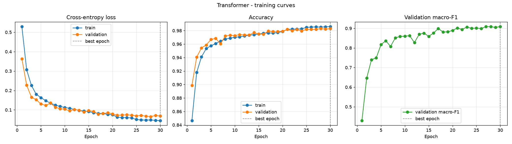
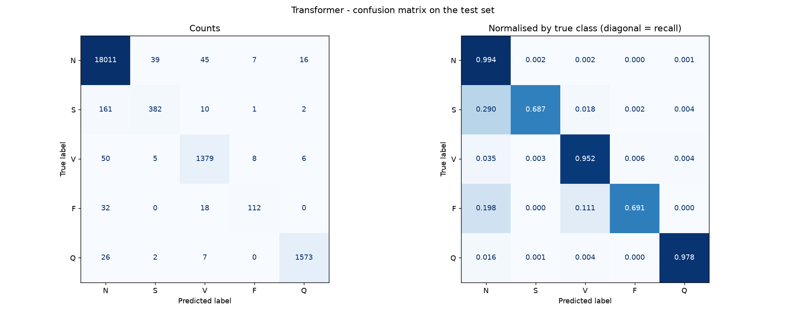
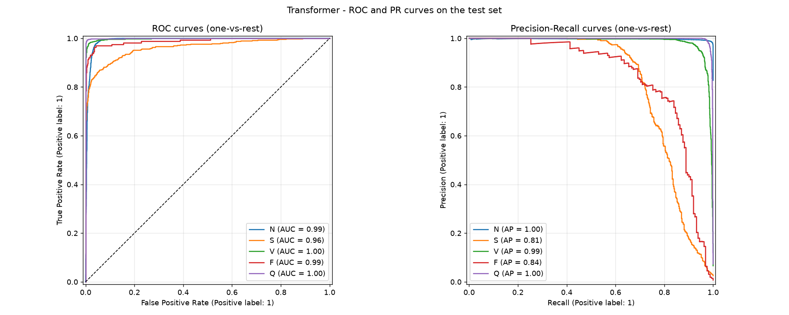
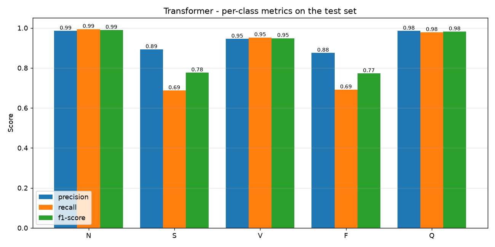
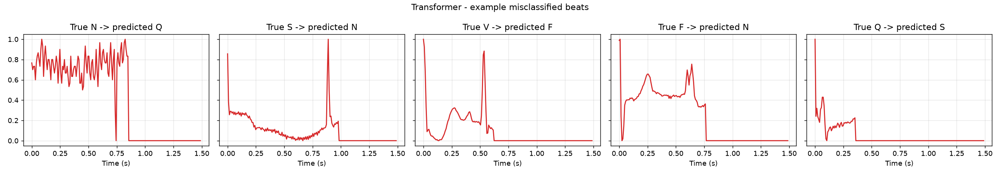
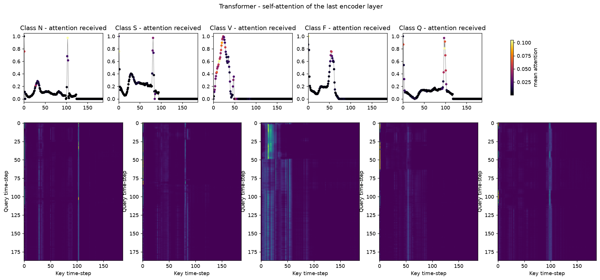

# Transformer - Metrics Analysis

Test set: official MIT-BIH test split (21,892 beats), never seen during training.

## Overall metrics

| Metric | Value |
|---|---|
| Accuracy | **0.9801** |
| Precision (macro) | 0.9366 |
| Recall (macro) | 0.8606 |
| F1-score (macro) | **0.8938** |
| Precision (weighted) | 0.9794 |
| Recall (weighted) | 0.9801 |
| F1-score (weighted) | 0.9793 |
| ROC-AUC (macro, one-vs-rest) | 0.9881 |
| Trainable parameters | 83,653 |
| Epochs trained (best epoch) | 30 (30) |
| Training time (cuda) | 7.0 min |
| Inference time per beat | 0.091 ms |

## Per-class report

```
                      precision    recall  f1-score   support

          Normal (N)     0.9853    0.9941    0.9897     18118
Supraventricular (S)     0.8925    0.6871    0.7764       556
     Ventricular (V)     0.9452    0.9523    0.9487      1448
          Fusion (F)     0.8750    0.6914    0.7724       162
         Unknown (Q)     0.9850    0.9782    0.9816      1608

            accuracy                         0.9801     21892
           macro avg     0.9366    0.8606    0.8938     21892
        weighted avg     0.9794    0.9801    0.9793     21892
```

## Analysis

- **Accuracy vs macro-F1:** accuracy is 98.01%, but ~83% of test beats are Normal, so accuracy is dominated by that class. Macro-F1 (0.8938) weights all five classes equally and is the fairer single number for this imbalanced problem.
- **Strongest class:** N (F1 = 0.9897). **Weakest class:** F (F1 = 0.7724, support = 162 beats).
- **Rare classes:** the mean recall on the two rarest classes, S and F, is 0.6892. Each has under 3% of the training data, so these are the hardest classes to learn.
- **Most frequent error:** 161 true **S** beats were predicted as **N**. S beats look very similar to Normal beats in a single-beat window, since the difference is mainly early timing, so this confusion is expected.
- **Over-fitting check:** at the selected epoch, train accuracy minus validation accuracy is +0.0031 (negligible - the model generalises well).
- **Separability:** a macro ROC-AUC of 0.9881 means the predicted probabilities rank the classes almost perfectly. A lot of the remaining F1 loss comes from the default arg-max decision threshold on the rare classes.

## Model-specific notes

- Every one of the 187 time-steps attends to all others (a 187x187 matrix per head per layer), so all positions are processed **in parallel**. This is the 'Medium (parallelizable)' speed on slide 12. The cost grows with the square of the sequence length.
- `attention_maps.png` shows which parts of each waveform the model relies on. Bright vertical bands in the matrix are time-steps (usually the R peak and T wave) that every other position looks at.

## Figures

### Training curves


### Confusion matrix


### ROC & Precision-Recall curves


### Per-class precision / recall / F1


### Example misclassified beats


### Attention Maps

