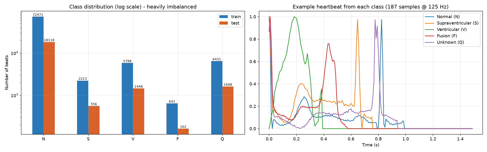
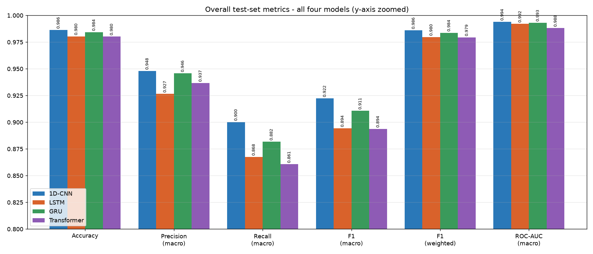
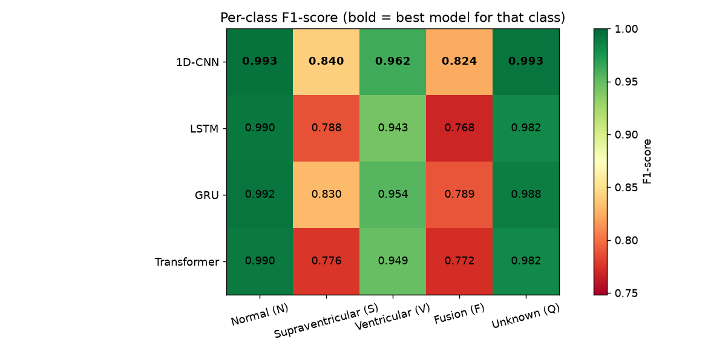
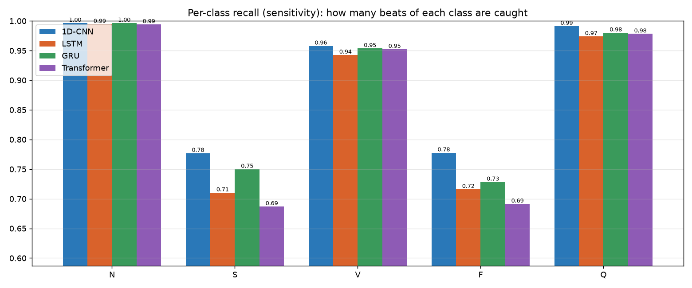
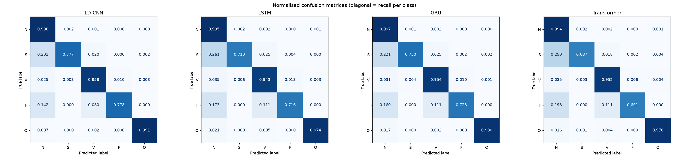
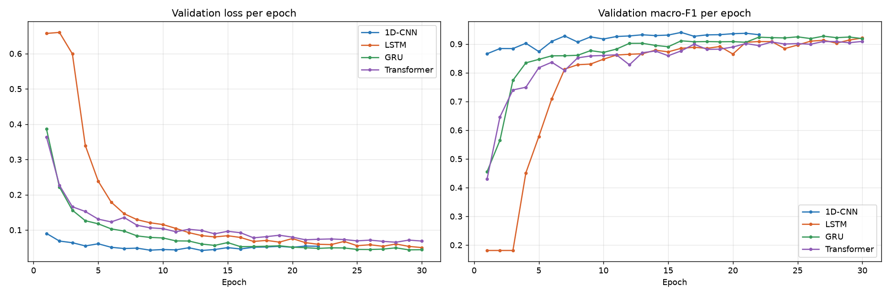
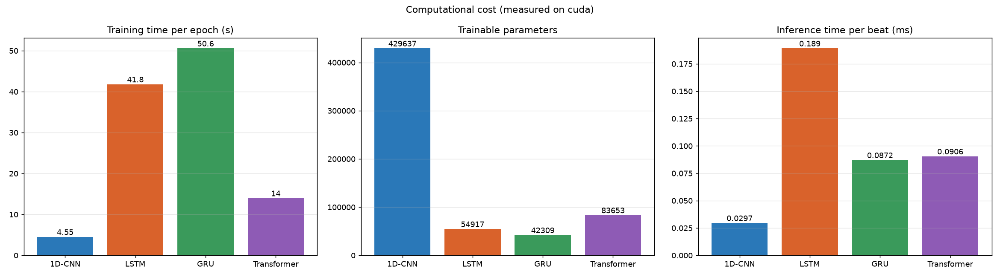
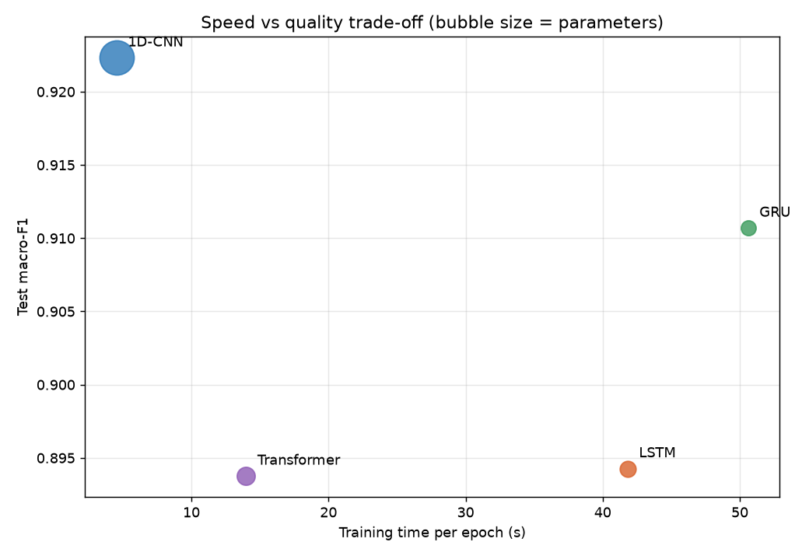

# ECG Arrhythmia Classification: Overall Model Comparison

MIT-BIH Arrhythmia dataset (Kaggle *ECG Heartbeat Categorization*): 87,554 training beats (10% held out for validation) and 21,892 test beats, 5 classes. All four models were trained with the same split, loss (cross-entropy), optimiser (Adam), early stopping and model selection (best validation macro-F1), using the shared `ecg_common.py`.



## Best model: 1D-CNN

**1D-CNN** achieves the highest **macro-F1 = 0.9223** (accuracy 0.9863, macro recall 0.9001, ROC-AUC 0.9939). The runner-up is GRU (macro-F1 0.9107).

**Why macro-F1 is the selection criterion:** 82.8% of the test beats are Normal, so a model that labels *every* beat Normal would already score 82.8% accuracy. Macro-F1 averages the F1-score of all five classes equally, so a model only scores well if it also detects the rare but clinically important S and F beats.

## Key findings

1. **1D-CNN is the best model** on every quality metric: accuracy, macro and weighted precision, recall and F1, and ROC-AUC. It also wins all five per-class F1 scores. This fits the slides' reasoning: the classes differ mainly in the *shape* of the P-QRS-T complex, and local convolution filters detect shape directly.
2. **It is also by far the cheapest to train:** 4.5 s per epoch vs 14.0-50.6 s for the others. Convolutions run in parallel over the whole beat.
3. **All four models reach ~98% accuracy**, and the differences only show on the rare classes. Supraventricular (S) and Fusion (F) are hardest for every model. S beats are mostly mistaken for Normal (their shape is near-normal; what makes them abnormal is early timing), and F beats are confused with N and V, since a fusion beat is a mix of both.
4. **Ranking vs slide 12 predictions:** CNN 'Fast' was confirmed. Transformer 'Medium (parallelizable)' was confirmed: ~3x the CNN's time per epoch, and much faster than the RNNs. LSTM/GRU 'Slow/Medium' was confirmed: the RNNs are the slowest because they process 187 steps sequentially.
5. **LSTM vs GRU (slide 8):** GRU has 23% fewer parameters and scored macro-F1 0.9107 vs 0.8943. So the lighter model was also more accurate. Per epoch, the **LSTM** was faster here (LSTM 41.8 s, GRU 50.6 s). This goes against the slide-12 expectation. On a GPU, both run through cuDNN kernels with packed variable-length sequences, and run time is dominated by the 187 sequential steps rather than the gate count, so the theoretical ~25% saving doesn't show up in wall-clock time.

> **Caveat - equal training budget:** LSTM, GRU, Transformer reached their best validation score in the last few of the 30 allowed epochs, so they were still improving when training stopped. 1D-CNN early-stopped on its own at epoch 22. With a larger epoch budget, the gap to the slower models may shrink. Under the same budget, though, 1D-CNN is clearly ahead, and its whole training run took 1.7 min vs 7.0-25.3 min for the others.

> **Implementation note:** every beat in this dataset is zero-padded at the end to 187 samples. The LSTM and GRU use `pack_padded_sequence`, so their final hidden state is taken at the real end of each beat. Without it, a trial LSTM run predicted 'Normal' for everything for 4 epochs, because it had to carry the beat information through ~140 padding steps.

## Overall metrics (test set)

| Model | Accuracy | Precision (macro) | Recall (macro) | F1 (macro) | F1 (weighted) | ROC-AUC | Params | Time / epoch | Mean rank |
|---|---|---|---|---|---|---|---|---|---|
| **1D-CNN** | 0.9863 | 0.9480 | 0.9001 | 0.9223 | 0.9860 | 0.9939 | 429,637 | 4.5 s | 1.00 |
| GRU | 0.9842 | 0.9457 | 0.8817 | 0.9107 | 0.9837 | 0.9931 | 42,309 | 50.6 s | 2.00 |
| LSTM | 0.9803 | 0.9266 | 0.8675 | 0.8943 | 0.9797 | 0.9921 | 54,917 | 41.8 s | 3.17 |
| Transformer | 0.9801 | 0.9366 | 0.8606 | 0.8938 | 0.9793 | 0.9881 | 83,653 | 14.0 s | 3.83 |

*Mean rank* is the average position across the 6 quality metrics (1 = best). Time per epoch was measured on `cuda` (NVIDIA RTX 4060 Laptop GPU).



## Per-class F1-score

| Class | 1D-CNN | LSTM | GRU | Transformer | Best |
|---|---|---|---|---|---|
| Normal (N) | **0.9932** | 0.9902 | 0.9922 | 0.9897 | 1D-CNN |
| Supraventricular (S) | **0.8405** | 0.7884 | 0.8299 | 0.7764 | 1D-CNN |
| Ventricular (V) | **0.9619** | 0.9430 | 0.9544 | 0.9487 | 1D-CNN |
| Fusion (F) | **0.8235** | 0.7682 | 0.7893 | 0.7724 | 1D-CNN |
| Unknown (Q) | **0.9925** | 0.9815 | 0.9878 | 0.9816 | 1D-CNN |





## Training behaviour and cost





- Fastest per epoch: **1D-CNN**.

## How to reproduce

```
pip install -r requirements.txt   # torch with CUDA: --index-url https://download.pytorch.org/whl/cu126
python 01_CNN/cnn_model.py
python 02_LSTM/lstm_model.py
python 03_GRU/gru_model.py
python 04_Transformer/transformer_model.py
python compare_models.py
```

## Per-model detailed reports

- [1D-CNN](01_CNN/results/metrics_analysis.md)
- [LSTM](02_LSTM/results/metrics_analysis.md)
- [GRU](03_GRU/results/metrics_analysis.md)
- [Transformer](04_Transformer/results/metrics_analysis.md)
